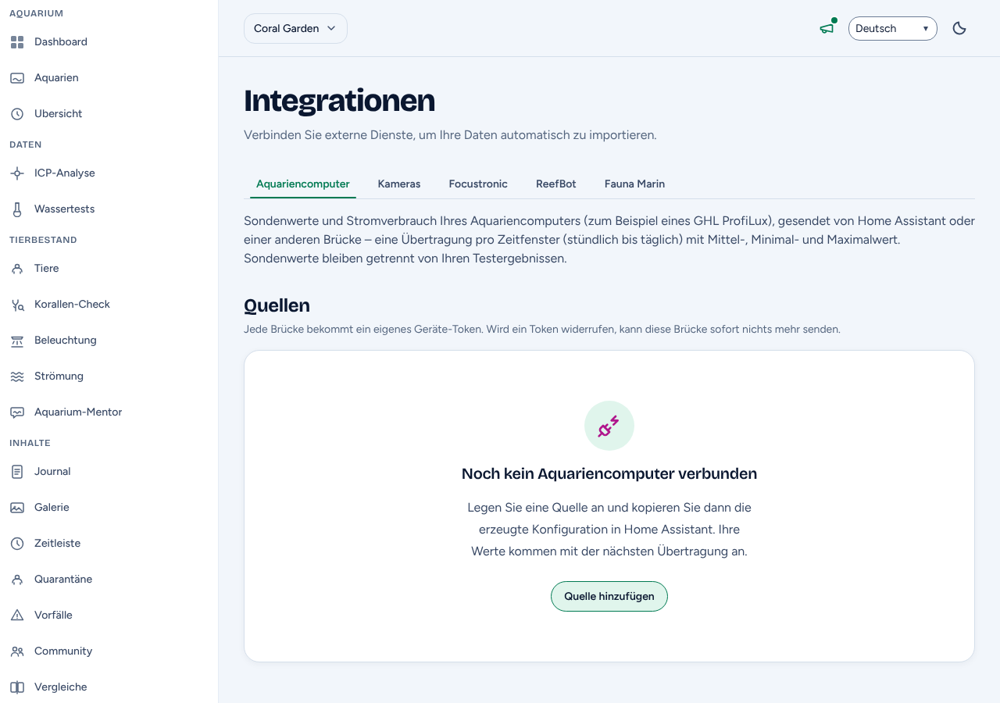
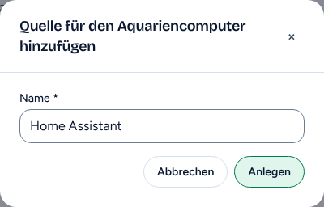
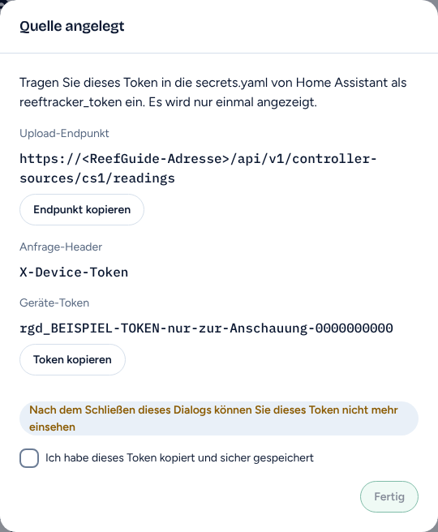
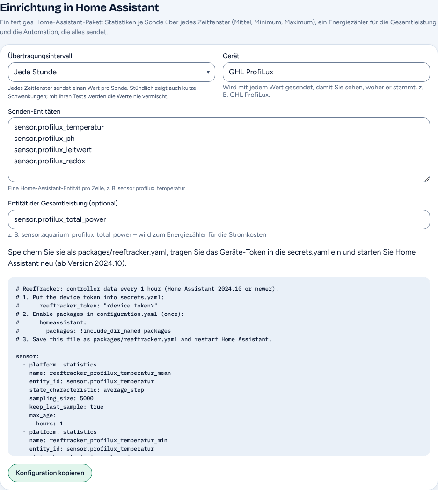
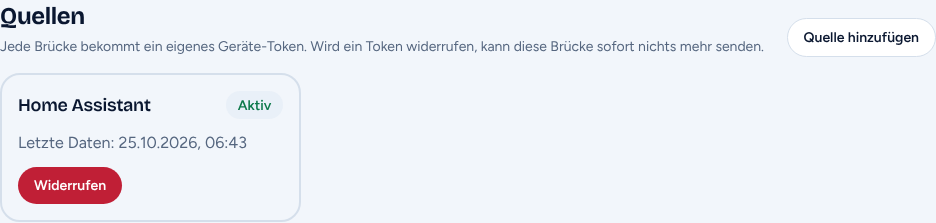
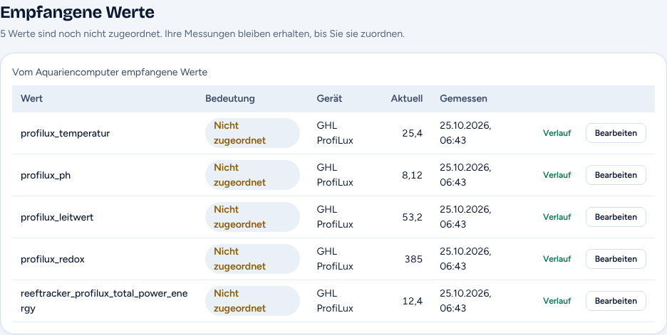
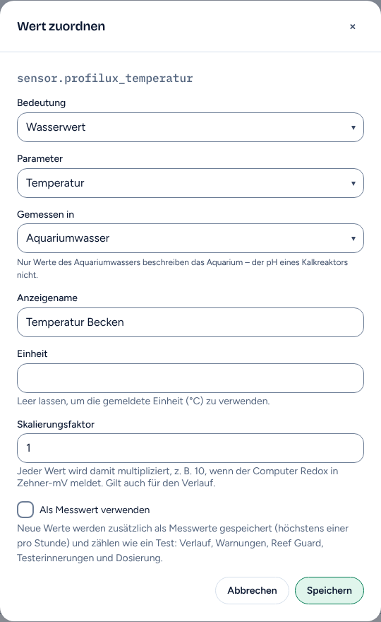
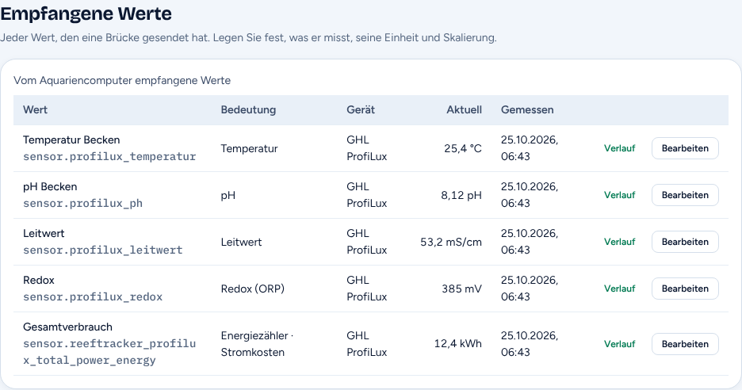
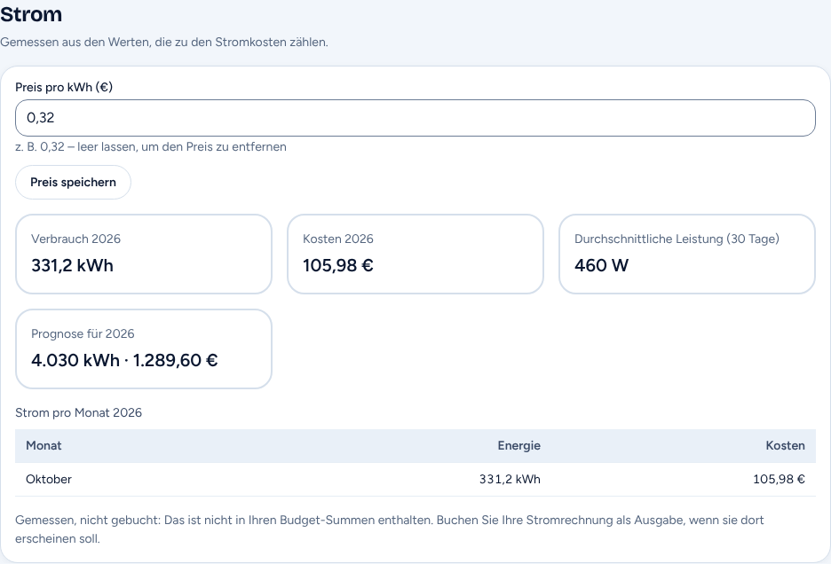

<!-- Kopie von rince-sp/reeftracker docs/anleitung-ghl-profilux-home-assistant.md (inkl. docs/images/ghl-profilux-home-assistant/). Änderungen bitte in beiden Repos nachziehen. -->
# GHL ProfiLux mit ReefGuide verbinden – über Home Assistant

**Eine Schritt-für-Schritt-Anleitung für Einsteiger**

Mit dieser Anleitung landen die Sondenwerte Ihres GHL ProfiLux (Temperatur, pH,
Leitwert/Salinität, Redox, Sauerstoff, … und auf Wunsch der Stromverbrauch)
automatisch in ReefGuide. Sie brauchen dafür keine Programmierkenntnisse – nur
etwas Geduld und diese Anleitung. Die Bildschirmfotos von ReefGuide zeigen
Beispieldaten; Ihre Namen und Werte sehen etwas anders aus. Rechnen Sie mit **30 bis 60 Minuten** beim
ersten Mal.

---

## Inhalt

1. [Wie das Ganze funktioniert](#1-wie-das-ganze-funktioniert)
2. [Was Sie brauchen](#2-was-sie-brauchen)
3. [Teil A – Die ProfiLux-Werte in Home Assistant bringen](#teil-a--die-profilux-werte-in-home-assistant-bringen)
4. [Teil B – ReefGuide vorbereiten](#teil-b--reefguide-vorbereiten)
5. [Teil C – Home Assistant zum Senden einrichten](#teil-c--home-assistant-zum-senden-einrichten)
6. [Teil D – Die Werte in ReefGuide zuordnen](#teil-d--die-werte-in-reefguide-zuordnen)
7. [Später etwas ändern](#später-etwas-ändern)
8. [Fehlerbehebung](#fehlerbehebung)
9. [Kleines Begriffslexikon](#kleines-begriffslexikon)

---

## 1. Wie das Ganze funktioniert

Ihr ProfiLux steht zu Hause in Ihrem Netzwerk, ReefGuide läuft im Internet. Die
beiden sprechen nicht direkt miteinander. **Home Assistant** (kurz **HA**) ist
die Brücke dazwischen:

```
 GHL ProfiLux  ──(Heimnetz)──▶  Home Assistant  ──(Internet, verschlüsselt)──▶  ReefGuide
  misst Werte                    sammelt Werte und                              zeigt Werte, Verläufe
                                 sendet sie regelmäßig                          und Stromkosten
```

Das sind zwei getrennte Wege, und Sie richten sie nacheinander ein:

- **ProfiLux → Home Assistant** (Teil A): Home Assistant muss die Werte Ihres
  ProfiLux kennen.
- **Home Assistant → ReefGuide** (Teile B und C): ReefGuide erzeugt eine fertige
  Konfiguration, die Sie in Home Assistant einfügen. Danach sendet Home Assistant
  die Werte selbstständig – stündlich bis einmal täglich, je nach Einstellung.

> ### ✅ Wichtig: Alle GHL-ProfiLux-Modelle und -Module funktionieren
>
> ReefGuide liest **nicht** direkt vom ProfiLux, sondern nimmt jeden Zahlenwert,
> den Home Assistant kennt. Deshalb ist es egal, welches Modell (ProfiLux 3,
> ProfiLux 4, ProfiLux mini …) oder welche Erweiterungsmodule und Sonden Sie
> verwenden: **Alles, was als Wert in Home Assistant ankommt, kann auch an
> ReefGuide gesendet werden.**
>
> Die in Teil A beschriebene **ProfiLux-Integration für Home Assistant**
> ([rince-sp/ha-ghl-profilux](https://github.com/rince-sp/ha-ghl-profilux)) ist
> dabei **eine Möglichkeit**, die Werte in Home Assistant zu bekommen – die
> einfachste, aber nicht die einzige. Haben Sie Ihre ProfiLux-Werte bereits auf
> einem anderen Weg in Home Assistant (eine andere Integration, MQTT, ein eigenes
> Skript …), überspringen Sie Teil A einfach und machen bei
> [Teil B](#teil-b--reefguide-vorbereiten) weiter.

---

## 2. Was Sie brauchen

Haken Sie diese Liste ab, bevor Sie anfangen:

- [ ] **Einen GHL ProfiLux**, der im selben Heimnetz hängt wie Home Assistant
      (per LAN-Kabel oder WLAN).
- [ ] **Die IP-Adresse des ProfiLux**, z. B. `192.168.1.50`. Sie finden sie in
      der GHL-App (GHL Connect / GHL Control Center) oder in Ihrem Router
      (z. B. FRITZ!Box → Heimnetz → Netzwerk).
      *Tipp:* Stellen Sie im Router ein, dass der ProfiLux immer dieselbe
      IP-Adresse bekommt – sonst verliert Home Assistant ihn nach einem
      Router-Neustart.
- [ ] **Home Assistant, Version 2024.10 oder neuer.** Die Version sehen Sie unter
      **Einstellungen → Info**.
- [ ] **Ein ReefGuide-Konto** mit mindestens einem angelegten Aquarium.
- [ ] **Eine Möglichkeit, Dateien in Home Assistant zu bearbeiten.** Am
      einfachsten ist das Add-on **File editor** (wird in Schritt C1 erklärt).

---

## Teil A – Die ProfiLux-Werte in Home Assistant bringen

> Haben Sie Ihre ProfiLux-Werte schon in Home Assistant? Dann weiter mit
> [Schritt A5](#schritt-a5-die-namen-der-werte-entitäts-ids-notieren) – den
> brauchen Sie trotzdem.

### Schritt A1: Die GHL API am ProfiLux einschalten

Die ProfiLux-Integration liest die Werte am besten über die offizielle,
lokale **GHL API**. Sie ist ab ProfiLux-Firmware **7.31** verfügbar, aber
**ab Werk ausgeschaltet** (und nach jedem Firmware-Update wieder aus).

1. Öffnen Sie **GHL Connect** oder **GHL Control Center** und verbinden Sie sich
   mit Ihrem ProfiLux.
2. Gehen Sie zu **System → GHL API**.
3. Schalten Sie die API ein. **Lesezugriff genügt.**
4. Speichern.

> Ältere Firmware oder ein ProfiLux 3? Kein Problem – überspringen Sie diesen
> Schritt. In Schritt A4 wählen Sie dann einfach eine andere Schnittstelle.

### Schritt A2: HACS installieren (falls noch nicht vorhanden)

**HACS** ist ein „App-Store“ für Home Assistant, über den Sie Erweiterungen von
der Community installieren. Prüfen Sie zuerst, ob links im Menü von Home
Assistant schon ein Eintrag **HACS** steht. Wenn ja: weiter mit Schritt A3.

Wenn nicht: Folgen Sie der offiziellen Anleitung unter
<https://hacs.xyz/docs/use/> („Download“ und „Initial configuration“). Danach
Home Assistant neu starten.

### Schritt A3: Die ProfiLux-Integration installieren

1. Klicken Sie links im Menü auf **HACS**.
2. Oben rechts auf die **drei Punkte (⋮)** → **Benutzerdefinierte Repositories**
   (englisch: *Custom repositories*).
3. Tragen Sie ein:
   - **Repository:** `https://github.com/rince-sp/ha-ghl-profilux`
   - **Typ / Kategorie:** `Integration`
4. **Hinzufügen** klicken und das Fenster schließen.
5. Suchen Sie in HACS nach **ProfiLux**, öffnen Sie den Eintrag und klicken Sie
   **Herunterladen**.
6. **Starten Sie Home Assistant neu:** **Einstellungen → System → oben rechts
   Ein/Aus-Symbol → Home Assistant neu starten**.

### Schritt A4: Den ProfiLux in Home Assistant hinzufügen

1. **Einstellungen → Geräte & Dienste**.
2. Unten rechts **+ Integration hinzufügen**.
3. Nach **ProfiLux** suchen und anklicken.
4. Das Formular ausfüllen:

   | Feld | Was Sie eintragen |
   |------|-------------------|
   | **Host** | Die IP-Adresse Ihres ProfiLux, z. B. `192.168.1.50` |
   | **Benutzername / Passwort** | Nur nötig, wenn Ihr ProfiLux welche verlangt – sonst Standard lassen bzw. leer |
   | **Schnittstelle** | siehe unten |

   **Welche Schnittstelle?**

   | Ihr Gerät | Schnittstelle |
   |-----------|---------------|
   | ProfiLux 4 mit Firmware 7.31 oder neuer, GHL API eingeschaltet (Schritt A1) | `ghl_api` (**empfohlen**) |
   | ProfiLux 4 mit Firmware 7.x ohne GHL API, ProfiLux mini | `websocket` |
   | ProfiLux 3 oder ältere ProfiLux-4-Firmware | `http` |

   Unsicher? Probieren Sie es in dieser Reihenfolge: `ghl_api` → `websocket` →
   `http`. Die richtige ist die, bei der die Einrichtung ohne Fehlermeldung
   klappt.

5. **Absenden**. Home Assistant findet jetzt automatisch alle Sonden und
   Steckdosen Ihres ProfiLux.

> ℹ️ Die Integration ist standardmäßig **nur lesend** – sie schaltet nichts an
> Ihrem Aquarium. Für ReefGuide ist das genau richtig.

### Schritt A5: Die Namen der Werte (Entitäts-IDs) notieren

Jeder Wert hat in Home Assistant einen eindeutigen technischen Namen, die
**Entitäts-ID**. Sie sieht zum Beispiel so aus: `sensor.profilux_temperatur`.
Genau diese Namen braucht ReefGuide gleich.

1. **Einstellungen → Geräte & Dienste → ProfiLux** → auf das Gerät klicken.
2. Sie sehen die Liste der Sensoren. Klicken Sie einen Sensor an, dann auf das
   **Zahnrad (Einstellungen)**. Dort steht die **Entitäts-ID**.
3. Schreiben Sie die Entitäts-IDs der Werte auf, die ReefGuide bekommen soll –
   z. B. in eine Textdatei, **eine pro Zeile**:

   ```
   sensor.profilux_temperatur
   sensor.profilux_ph
   sensor.profilux_leitwert
   sensor.profilux_redox
   ```

   *Ihre Namen können anders lauten* – sie richten sich nach den Namen, die Sie
   Ihren Sonden im ProfiLux gegeben haben. Verwenden Sie immer die Namen aus
   **Ihrem** Home Assistant.

4. **Optional – Stromverbrauch:** Die Integration liefert einen Sensor
   **Total power** (Gesamtleistung in Watt), z. B. `sensor.profilux_total_power`.
   Notieren Sie dessen Entitäts-ID separat, wenn ReefGuide Ihre Stromkosten
   berechnen soll.

> **Schneller Weg für alle Werte:** **Entwicklerwerkzeuge → Zustände** und oben
> im Filter `profilux` eingeben. Die linke Spalte zeigt alle Entitäts-IDs, die
> mittlere die aktuellen Werte. So sehen Sie auch gleich, ob die Werte stimmen.

> **Tipp:** Senden Sie nur Sondenwerte (Temperatur, pH, Leitwert, Redox,
> Sauerstoff …). Die einzelnen Steckdosen (`binary_sensor.…`) braucht ReefGuide
> nicht.

---

## Teil B – ReefGuide vorbereiten

### Schritt B1: Die Seite „Aquariencomputer“ öffnen

1. Melden Sie sich bei ReefGuide an.
2. Wählen Sie das Aquarium, zu dem der ProfiLux gehört.
3. Öffnen Sie im Menü **Integrationen** und dort den Reiter
   **Aquariencomputer**.



### Schritt B2: Eine Quelle anlegen und das Geräte-Token sichern

Eine **Quelle** ist in ReefGuide die „Eingangstür“ für Ihre Home-Assistant-Daten.
Sie bekommt einen geheimen Schlüssel, das **Geräte-Token**.

1. Klicken Sie **Quelle hinzufügen**.
2. Als Name ist `Home Assistant` vorgeschlagen – lassen Sie das so oder wählen
   Sie einen eigenen Namen.
3. **Anlegen** klicken.



4. Jetzt erscheint das **Geräte-Token**. Klicken Sie **Token kopieren** und
   fügen Sie es z. B. in eine Textdatei ein.
5. Setzen Sie den Haken **„Ich habe dieses Token kopiert und sicher
   gespeichert“** und klicken Sie **Fertig**.

   *Upload-Endpunkt und Anfrage-Header brauchen Sie nicht abzuschreiben – sie
   stehen schon in der Konfiguration, die ReefGuide gleich für Sie erzeugt.*



> ⚠️ **Das Token wird nur ein einziges Mal angezeigt!** Kopieren Sie es jetzt
> und speichern Sie es kurz zwischen (z. B. in einer Textdatei). Geben Sie es an
> niemanden weiter – wer es hat, kann Werte in Ihr Aquarium schreiben.
>
> Token verloren? Kein Drama: Widerrufen Sie die Quelle und legen Sie eine neue
> an.

### Schritt B3: Die Home-Assistant-Konfiguration erzeugen

Unter der Quelle erscheint jetzt der Abschnitt **Einrichtung in Home
Assistant**. Füllen Sie ihn aus:

| Feld | Was Sie eintragen |
|------|-------------------|
| **Übertragungsintervall** | Wie oft Home Assistant sendet. **Jede Stunde** ist ein guter Start – dann sehen Sie auch kurze Schwankungen. |
| **Gerät** | `GHL ProfiLux` – so sehen Sie später, woher ein Wert stammt. |
| **Sonden-Entitäten** | Ihre Liste aus Schritt A5, **eine Entitäts-ID pro Zeile**. Löschen Sie die Beispielwerte vorher. |
| **Entität der Gesamtleistung (optional)** | Die Total-power-Entität aus Schritt A5, z. B. `sensor.profilux_total_power`. Leer lassen, wenn Sie keinen Strom erfassen wollen. |

Darunter erscheint automatisch die fertige Konfiguration (ein Textblock).
Klicken Sie **Konfiguration kopieren** und speichern Sie den Text kurz
zwischen.



> Steht unter einem Feld „Keine Home-Assistant-Entität: …“? Dann ist ein Name
> falsch geschrieben. Entitäts-IDs bestehen nur aus Kleinbuchstaben, Ziffern,
> Unterstrichen und genau einem Punkt.

> **Was macht diese Konfiguration?** Sie bildet für jede Sonde über jedes
> Zeitfenster den **Mittel-, Minimal- und Maximalwert**, rechnet die
> Gesamtleistung in einen **Energiezähler (kWh)** um und schickt alles zum
> Ende jedes Zeitfensters an ReefGuide. Sie müssen darin nichts ändern.

---

## Teil C – Home Assistant zum Senden einrichten

Jetzt fügen Sie die Konfiguration in Home Assistant ein. Das sind drei Dateien
im Konfigurationsordner von Home Assistant:

| Datei | Was hineinkommt |
|-------|-----------------|
| `secrets.yaml` | das Geräte-Token |
| `configuration.yaml` | einmalig zwei Zeilen, damit Home Assistant „Pakete“ lädt |
| `packages/reeftracker.yaml` | die kopierte Konfiguration aus ReefGuide (neue Datei) |

### Schritt C1: Den File editor installieren

> Wenn Sie Ihre Home-Assistant-Dateien schon anders bearbeiten (z. B. mit
> *Studio Code Server* oder über eine Netzwerkfreigabe), überspringen Sie
> diesen Schritt.

1. **Einstellungen → Add-ons** (in neueren Versionen heißt das Menü **Apps**)
   → unten rechts **Add-on-Store**.
2. Nach **File editor** suchen, öffnen, **Installieren**.
3. Nach der Installation **In Seitenleiste anzeigen** einschalten und
   **Starten**.
4. Links im Menü erscheint jetzt **File editor**.

> Sie sehen kein Menü „Add-ons“/„Apps“? Dann läuft Ihr Home Assistant als
> *Container* (Docker). Bearbeiten Sie die Dateien dann direkt im
> Konfigurationsordner (dort, wo `configuration.yaml` liegt) mit einem
> Texteditor.

### Schritt C2: Das Token in die `secrets.yaml` eintragen

1. Öffnen Sie den **File editor**.
2. Oben links auf das **Ordner-Symbol** klicken und `secrets.yaml` auswählen.
   (Gibt es sie nicht, legen Sie sie mit dem Symbol **Neue Datei** an.)
3. Fügen Sie **ganz unten** eine neue Zeile ein – mit Ihrem Token aus
   Schritt B2 zwischen den Anführungszeichen:

   ```yaml
   reeftracker_token: "HIER-IHR-GERÄTE-TOKEN"
   ```

4. Oben rechts auf das **Speichern-Symbol** (Diskette) klicken.

### Schritt C3: Pakete in der `configuration.yaml` einschalten (einmalig)

1. Im File editor `configuration.yaml` öffnen.
2. Prüfen Sie, ob es schon eine Zeile gibt, die genau mit `homeassistant:`
   beginnt (ganz links, ohne Leerzeichen davor).

   **Fall 1 – es gibt noch keine `homeassistant:`-Zeile:** Fügen Sie ganz
   unten ein:

   ```yaml
   homeassistant:
     packages: !include_dir_named packages
   ```

   **Fall 2 – es gibt sie schon:** Schreiben Sie **keine zweite**
   `homeassistant:`-Zeile! Fügen Sie stattdessen direkt darunter nur die Zeile
   `packages: …` ein, mit **zwei Leerzeichen** davor:

   ```yaml
   homeassistant:
     packages: !include_dir_named packages
     # … Ihre bisherigen Einträge bleiben, wie sie sind
   ```

   Steht dort schon eine `packages:`-Zeile, ist alles erledigt – nichts ändern.

3. **Speichern.**

> ⚠️ In YAML-Dateien zählen die **Leerzeichen am Zeilenanfang**. Verwenden Sie
> Leerzeichen, keine Tabulatoren, und rücken Sie genau wie im Beispiel ein.

### Schritt C4: Die Paket-Datei anlegen

1. Im File editor auf das **Ordner-Symbol** klicken.
2. Mit dem Symbol **Neuer Ordner** einen Ordner namens `packages` anlegen
   (direkt neben `configuration.yaml`, nicht in einem Unterordner).
3. In den Ordner `packages` wechseln und mit **Neue Datei** die Datei
   `reeftracker.yaml` anlegen.
4. Die in Schritt B3 kopierte Konfiguration **komplett** einfügen – nichts
   weglassen, nichts ändern.
5. **Speichern.**

Die Ordnerstruktur sieht danach so aus:

```
config/
├── configuration.yaml
├── secrets.yaml
└── packages/
    └── reeftracker.yaml
```

### Schritt C5: Konfiguration prüfen und Home Assistant neu starten

1. **Entwicklerwerkzeuge → YAML** → **Konfiguration prüfen**.
   - Erscheint **„Konfiguration gültig!“** (bzw. *Configuration will not
     prevent Home Assistant from starting*): weiter.
   - Erscheint ein Fehler: Lesen Sie die Meldung – meist ist es ein
     Einrückungsfehler in der `configuration.yaml` oder ein Tippfehler im
     Token-Namen. Siehe [Fehlerbehebung](#fehlerbehebung).
2. **Neu starten**: **Einstellungen → System → Ein/Aus-Symbol oben rechts →
   Home Assistant neu starten**.

> Ein „Neu laden“ der YAML-Konfiguration genügt hier nicht – beim ersten Mal
> braucht es einen **echten Neustart**.

### Schritt C6: Die erste Übertragung testen

Sie müssen nicht bis zur nächsten vollen Stunde warten:

1. **Einstellungen → Automationen & Szenen**.
2. Suchen Sie die Automation **„ReefTracker: send controller data“**.
3. Rechts auf die **drei Punkte (⋮)** → **Ausführen** (bzw. *Aktionen
   ausführen*).
4. Wechseln Sie zu ReefGuide (**Integrationen → Aquariencomputer**) und laden
   Sie die Seite neu. Bei Ihrer Quelle steht jetzt **„Letzte Daten: …“** mit
   der aktuellen Uhrzeit.



🎉 **Geschafft – die Verbindung steht!** Ab jetzt sendet Home Assistant
automatisch zu jedem vollen Zeitfenster (bei „Jede Stunde“ also zu jeder
vollen Stunde).

> Direkt nach dem Neustart hat Home Assistant noch keine Statistik über ein
> ganzes Zeitfenster gesammelt. Der Test sendet dann einfach den aktuellen Wert.
> Mittel-, Minimal- und Maximalwerte kommen ab dem ersten vollen Zeitfenster.

---

## Teil D – Die Werte in ReefGuide zuordnen

ReefGuide weiß noch nicht, **was** jeder empfangene Wert bedeutet. Das legen Sie
einmal fest.

### Schritt D1: Jeden Wert zuordnen

1. In ReefGuide unter **Integrationen → Aquariencomputer** zum Abschnitt
   **Empfangene Werte** scrollen. Dort steht jeder Wert, den Home Assistant
   gesendet hat – zunächst als **„Nicht zugeordnet“**.


2. Bei einem Wert auf **Bearbeiten** klicken und ausfüllen:

   | Feld | Was Sie wählen |
   |------|----------------|
   | **Bedeutung** | **Wasserwert** für Sonden (Temperatur, pH, …), **Leistung** bzw. **Energiezähler** für Strom, **Ignoriert** für alles, was Sie nicht brauchen |
   | **Parameter** | z. B. *Temperatur*, *pH*, *Leitwert*, *Salinität*, *Redox (ORP)*, *Sauerstoff* |
   | **Gemessen in** | **Aquariumwasser** für Sonden im Becken/Technikbecken. **Reaktor** z. B. für die pH-Sonde im Kalkreaktor – deren Wert beschreibt nicht Ihr Aquarium |
   | **Anzeigename** | ein Name, den Sie wiedererkennen, z. B. „Temperatur Becken“ |
   | **Einheit** | leer lassen, dann gilt die Einheit aus Home Assistant |
   | **Skalierungsfaktor** | normalerweise `1`. Nur ändern, wenn ein Wert um einen festen Faktor falsch ist (z. B. `10`, wenn Redox in Zehner-mV ankommt) |




3. **Speichern.** Das wiederholen Sie für jeden Wert. Am Ende sieht die
   Tabelle etwa so aus:



### Schritt D2 (optional): Sondenwerte wie einen Test verwenden

Normalerweise bleiben Sondenwerte **getrennt** von Ihren Handtests. Wenn Sie
möchten, dass eine Sonde wie ein Test zählt (Verlauf, Warnungen, Reef Guard,
Testerinnerungen, Dosierung), haken Sie beim Wert **Als Messwert verwenden** an.
Das geht nur in der Einheit des Handtests (z. B. °C, dKH, ppm) – stellen Sie
dafür die passende **Einheit** ein.

### Schritt D3 (optional): Stromkosten

1. Beim Energiezähler-Wert (er heißt z. B.
   `sensor.reeftracker_profilux_total_power_energy`) als Bedeutung
   **Energiezähler** wählen und **Zählt zu den Stromkosten** anhaken.
   *Haken Sie nur die Gesamtleistung bzw. den Gesamtzähler an – nicht zusätzlich
   einzelne Steckdosen, sonst wird doppelt gezählt.*
2. Weiter unten im Abschnitt **Strom** den **Preis pro kWh** eintragen
   (z. B. `0,32`) und **Preis speichern**.

Ab jetzt sehen Sie Verbrauch, Kosten und eine Jahresprognose – hier und im
Budget unter **Strom (gemessen)**. Diese Werte sind *gemessen, nicht gebucht*:
Sie fließen nicht automatisch in Ihre Budget-Summen ein. Soll Ihre
Stromrechnung dort erscheinen, buchen Sie sie als Ausgabe.



---

## Später etwas ändern

- **Eine Sonde hinzufügen oder entfernen, Intervall ändern:** In ReefGuide die
  Felder unter **Einrichtung in Home Assistant** anpassen, **Konfiguration
  kopieren**, den Inhalt von `packages/reeftracker.yaml` damit **komplett
  ersetzen**, speichern und Home Assistant neu starten.
- **Neues Token:** Quelle in ReefGuide widerrufen, neue Quelle anlegen, neues
  Token in der `secrets.yaml` ersetzen, Home Assistant neu starten.
- **Verbindung beenden:** Quelle in ReefGuide **widerrufen** – ab sofort nimmt
  ReefGuide nichts mehr an. Bereits empfangene Werte bleiben erhalten. Danach
  `packages/reeftracker.yaml` in Home Assistant löschen und neu starten.

---

## Fehlerbehebung

| Problem | Ursache & Lösung |
|---------|------------------|
| **ProfiLux lässt sich in Home Assistant nicht hinzufügen** | IP-Adresse prüfen (im Browser `http://<IP>` öffnen – kommt die ProfiLux-Seite?). Andere **Schnittstelle** probieren. Bei `ghl_api`: Ist die GHL API eingeschaltet (Schritt A1)? Nach einem Firmware-Update ist sie wieder aus. |
| **In HACS ist „ProfiLux“ nicht zu finden** | Das benutzerdefinierte Repository wurde nicht als Kategorie **Integration** hinzugefügt (Schritt A3). |
| **„Konfiguration prüfen“ meldet einen Fehler mit `secrets.yaml` / `reeftracker_token`** | Die Zeile in der `secrets.yaml` fehlt oder ist falsch geschrieben. Sie muss genau `reeftracker_token: "…"` heißen (Schritt C2). |
| **Fehler „duplicated mapping key“ / doppelter Schlüssel** | In der `configuration.yaml` gibt es zwei `homeassistant:`-Zeilen. Zu einer zusammenführen (Schritt C3, Fall 2). |
| **Die Automation „ReefTracker: send controller data“ gibt es nicht** | Pakete sind nicht eingeschaltet, der Ordner heißt nicht genau `packages`, die Datei liegt am falschen Ort oder Home Assistant wurde nicht neu gestartet (Schritte C3–C5). |
| **ReefGuide zeigt „Noch keine Daten empfangen“** | Automation einmal von Hand ausführen (Schritt C6). Danach **Einstellungen → System → Protokolle** auf Meldungen zu `rest_command` prüfen. Häufig: Token falsch kopiert oder die Quelle wurde widerrufen. Home Assistant braucht Internetzugang. |
| **Fehler 401 / „Unauthorized“ im Protokoll** | Das Token stimmt nicht oder gehört zu einer widerrufenen Quelle. Neue Quelle anlegen und Token ersetzen. |
| **„Seit über einem Tag keine Daten“** | Home Assistant war aus, hatte kein Internet, oder die Automation wurde deaktiviert. Unter **Einstellungen → Automationen & Szenen** prüfen, ob sie eingeschaltet ist. |
| **Ein Wert fehlt in ReefGuide** | Steht seine Entitäts-ID in der Liste aus Schritt B3? Zeigt Home Assistant für ihn eine Zahl (nicht „unbekannt“ / „nicht verfügbar“)? Nur Zahlenwerte werden gesendet. |
| **Ein Wert ist um den Faktor 10 / 100 falsch** | In ReefGuide beim Wert den **Skalierungsfaktor** anpassen (Schritt D1). |
| **Entitäts-IDs haben sich geändert** (z. B. Sonde im ProfiLux umbenannt) | Neue IDs in ReefGuide unter **Sonden-Entitäten** eintragen, Konfiguration neu kopieren und `packages/reeftracker.yaml` ersetzen. Die neuen Werte anschließend wieder zuordnen. |

---

## Kleines Begriffslexikon

| Begriff | Bedeutung |
|---------|-----------|
| **Home Assistant (HA)** | Kostenlose Software für das Smart Home, läuft z. B. auf einem Raspberry Pi oder einem kleinen PC zu Hause. |
| **Integration** | Eine Erweiterung, mit der Home Assistant ein bestimmtes Gerät versteht – hier den ProfiLux. |
| **HACS** | „Home Assistant Community Store“ – damit installieren Sie Integrationen aus der Community. |
| **Entität / Entitäts-ID** | Ein einzelner Wert in Home Assistant und sein technischer Name, z. B. `sensor.profilux_temperatur`. |
| **Quelle** | In ReefGuide der Eingang für die Daten einer Brücke (hier Home Assistant). |
| **Geräte-Token** | Geheimer Schlüssel, mit dem sich Home Assistant bei ReefGuide ausweist. |
| **Paket (Package)** | Eine Datei im Ordner `packages`, die zusammengehörige Home-Assistant-Einstellungen bündelt – hier alles für ReefGuide. |
| **YAML** | Das Textformat der Home-Assistant-Konfiguration. Einrückungen mit Leerzeichen sind darin wichtig. |
| **Zeitfenster / Übertragungsintervall** | Der Zeitraum, über den Mittel-, Minimal- und Maximalwert gebildet und dann gesendet werden (1 bis 24 Stunden). |
